# 🫘 Nephrology Clinical Evidence Assistant

[](LICENSE)
[](https://www.python.org/)
[](https://streamlit.io/)

A clinical decision support assistant that queries both **clinical practice guidelines** (e.g., KDIGO 2026 AKI/AKD) and **peer-reviewed research publications** (clinical trials, meta-analyses, reviews) — with a source selector that lets clinicians choose their evidence type.

Every answer is strictly grounded in the indexed documents, with exact source citations attached to every claim. When searching "Both" sources, the assistant clearly distinguishes between guideline recommendations and research findings.

---

## 🎯 Why This Exists

Medical clinical practice guidelines are often 500+ pages long, packed with complex staging grids, diagnostic criteria, and decision trees. When clinicians need to make time-sensitive decisions on the ward—such as determining AKI staging, selecting baseline creatinine, reviewing nephrotoxic medication rules, or planning post-discharge follow-up—flipping through a massive PDF takes valuable time.

This project delivers a **grounded, citation-backed conversational assistant** that allows clinicians to ask direct questions in natural language (in English or German) and receive evidence-based, page-cited answers in seconds.

---

## Intended Purpose

This is a research prototype demonstrating grounded retrieval-augmented generation for clinical guideline lookup. It is intended to help clinicians, pharmacists, or students quickly locate guideline-based information during research or education - not to autonomously diagnose, recommend treatment, 
or replace an infectious disease (ID) consult. All outputs must be verified against the cited source before any clinical use.

---

## 💡 Key Clinical Features & Upgrades

- **Dual Evidence Sources (Guidelines + Publications):** Clinicians can search **guidelines** (KDIGO 2026), **publications** (research papers, trials), or **both** — with a clean radio selector in the sidebar. When searching both, each answer clearly labels whether a claim comes from a guideline recommendation or a research finding.
- **Preserved Clinical Tables:** Unlike standard PDF text extractors that break multi-row criteria, the ingestion engine (`pdfplumber`) extracts tables as intact Markdown grids (`[TABLE START] ... [TABLE END]`). Complex staging grids (e.g., AKI staging by SCr and Urine Output) remain structured and fully aligned.
- **Flowchart & Algorithm Ingestion:** Standard RAG pipelines are blind to embedded diagrams and decision trees. This assistant injects manually verified semantic descriptions of critical KDIGO algorithms (e.g., *Figure 9: Multicomponent Kidney Protection Strategy*, *Figure 12: Contrast-Associated AKI Risk Assessment*, *Figure 22: Post-Discharge Follow-up Framework*).
- **True Printed Page Numbers:** Uses PyMuPDF (`fitz`) to extract logical page numbers matching the document's printed pages, rather than offset PDF index numbers.
- **Multi-Query Synonym Expansion:** Uses a clinical query generator that expands acronyms and non-English terminology (e.g., German terms like *OAK* $\rightarrow$ *Oral Anticoagulation*, *ANV* $\rightarrow$ *Acute Kidney Injury*, *RRT* $\rightarrow$ *Renal Replacement Therapy*) into targeted medical search queries.
- **Diverse Retrieval (MMR) & FlashRank Reranking:** Merges candidate chunks across queries using Maximal Marginal Relevance (MMR) for breadth across 500 pages, followed by ultra-fast local cross-encoder reranking (`FlashRank`) to deliver high-precision context to the LLM.
- **MedTech UI Design:** A modern, clean Streamlit frontend inspired by Apple and Gemini design principles, complete with a KDIGO chapter navigator, clinical disclaimer, and a one-click session reset for ward device handoffs.

---

## 🔄 End-to-End Architecture

```mermaid
flowchart LR
    %% ── Ingestion & Indexing Pipeline ──
    subgraph Ingestion [" 📚 1. Document Ingestion & Indexing "]
        direction LR
        GPDF["Guidelines PDFs\n(KDIGO 2026)"] -->|pdfplumber\n+ PyMuPDF| Parser["Markdown Tables\n+ Clean Text Blocks"]
        PPDF["Publication PDFs\n(Trials, Reviews)"] -->|pdfplumber\n+ PyMuPDF| Parser2["Markdown Tables\n+ Clean Text Blocks"]
        Figs["Figure Annotations\n(figure_annotations.json)"] --> Parser
        Parser -->|RecursiveCharacterSplitter\n\\n\\n table-safe| GChunks["Guideline Chunks"]
        Parser2 -->|RecursiveCharacterSplitter\n\\n\\n table-safe| PChunks["Publication Chunks"]
        GChunks -->|e5-mistral-7b-instruct\nEmbeddings| GVDB[("FAISS\nGuidelines Index")]
        PChunks -->|e5-mistral-7b-instruct\nEmbeddings| PVDB[("FAISS\nPublications Index")]
    end

    %% ── Query & Generation Pipeline ──
    subgraph Retrieval [" 🩺 2. Clinical Retrieval & Answering "]
        direction LR
        User["User Question\n+ Source Selection"] -->|Qwen-30B| MQ["Multi-Query Expansion\n(3 clinical synonyms)"]
        MQ -->|MMR Search\nk=10, fetch_k=25| Search["Candidate Chunks\nfrom selected source"]
        Search -->|FlashRank\nLocal Cross-Encoder| Rerank["Top-5 Most Relevant\nChunks"]
        Rerank --> Formatter["Format Context\nwith [Source, p.X] citations"]
        Formatter --> LLM["Qwen-30B-Instruct\n(Source-Aware Prompt)"]
        LLM --> UI["Cited Clinical Answer\nStreamlit MedTech UI"]
    end

    %% Flow connector
    Ingestion -.-> Retrieval
```



---

## 🚀 Getting Started

### 1. Clone the repository
```bash
git clone https://github.com/sunilkumar-nallani/Bacteremia_Clinical_Guideline_Assistant.git
cd Bacteremia_Clinical_Guideline_Assistant
```

### 2. Set up virtual environment and install dependencies
```bash
python -m venv venv
.\venv\Scripts\activate      # On Windows
# source venv/bin/activate   # On Linux/macOS

pip install -r requirements.txt
```

### 3. Environment Configuration
Create a `.env` file in the project root:
```env
OPENAI_API_KEY=your_api_key_here
OPENAI_API_BASE=https://chat-ai.academiccloud.de/v1   # Optional custom endpoint
```

### 4. Build the Vector Store Indexes
Place your guideline PDFs in `documents/guidelines/` and any research publication PDFs in `documents/publications/`, then run:
```bash
python Build_Index.py
```
*This builds separate FAISS indexes for guidelines and publications. The app will show available source types based on which indexes were built.*

> **Note:** The app also supports the legacy folder structure (`Nephrology_Guidelines/`) for backward compatibility.

### 5. Launch the Clinical Assistant
```bash
streamlit run app.py
```

---

## 🩺 Guardrails & Clinical Verification

1. **Strict Source Grounding:** The assistant is explicitly instructed to answer *only* from retrieved excerpts. If the indexed documents do not address a clinical scenario, it truthfully states that the information is not available rather than inventing recommendations.
2. **Mandatory Citations:** Every single clinical statement includes a direct citation tag: `[KDIGO 2026, p.X]` for guidelines or `[Source: filename, p.X]` for publications.
3. **Source Type Tagging:** In "Both" mode, each claim is explicitly labeled as coming from a guideline recommendation or a research finding, so clinicians can weigh evidence appropriately.
4. **Recommendation Grading:** Whenever available in the context, specific KDIGO recommendation grades (e.g., *Recommendation 3.2.3, Grade 1B*) are cited.
5. **Draft Notice:** The system displays a prominent clinical disclaimer indicating that answers are sourced from indexed documents and require verification against the original text and individual clinical judgement.

---

## 🛠️ Tech Stack

- **Frameworks:** [LangChain](https://www.langchain.com/) · [LangChain Classic](https://pypi.org/project/langchain-classic/)
- **Document Parsing:** [pdfplumber](https://github.com/jsvine/pdfplumber) (Table extraction) · [PyMuPDF](https://pymupdf.readthedocs.io/) (Page labels & text)
- **Vector Database:** [FAISS (Facebook AI Similarity Search)](https://github.com/facebookresearch/faiss)
- **Reranker:** [FlashRank](https://github.com/PrithivirajDamodaran/FlashRank) (Local ultra-fast cross-encoder)
- **LLM & Embeddings:** Qwen-30B / e5-mistral-7b-instruct via OpenAI-compatible API
- **Frontend UI:** [Streamlit](https://streamlit.io/) with custom clinical CSS

---

## ⚠️ Limitations & Ethical Disclaimer

- **Research & Prototyping Only:** This application is designed for research, education, and decision support—it is **not** an autonomous medical device and does not replace professional nephrology consultation or clinical diagnosis.
- **Human-in-the-Loop:** Clinicians must always verify cited pages and data points before acting on any output.
- **Document Scope:** The assistant's knowledge boundary is strictly limited to the loaded guideline and publication PDFs. It does not search the internet or external databases.

---

## Regulatory Context (EU AI Act)

This prototype is a retrieval tool grounded in static guideline documents. It is not currently a safety component of a medical device and is not marketed for clinical deployment, so under the AI Act's Article 6 classification logic it would not currently fall under Annex I. If adapted for real clinical use - e.g., directly influencing treatment decisions in a hospital workflow - its intended purpose and safety role would need to be reassessed, likely triggering medical-device (MDR) and Annex I considerations. This project was built with that distinction in mind: strict grounding, mandatory citations, and explicit non-diagnostic framing are deliberate design choices to keep the current version outside high-risk territory while demonstrating the safety principles that would apply if it were scaled toward real use.

---

## 👤 Author & Contact

**Sunil Kumar Nallani**  
- Email: sunilkumar.nallani@stud.uni-goettingen.de  
- LinkedIn: [linkedin.com/in/nallani-sunil-kumar-67227a243](https://www.linkedin.com/in/nallani-sunil-kumar-67227a243/)  
- GitHub: [github.com/sunilkumar-nallani](https://github.com/sunilkumar-nallani)

---

## 📄 License

This project is open source and available under the [MIT License](LICENSE).
